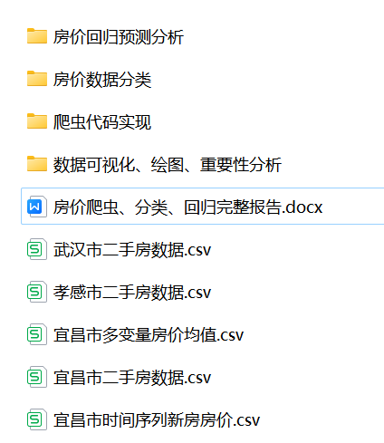
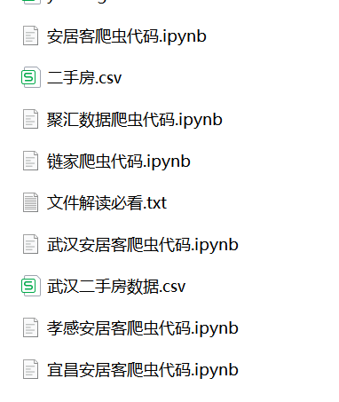
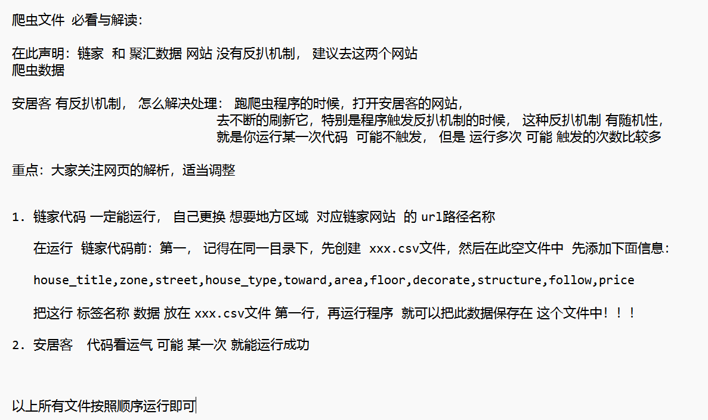
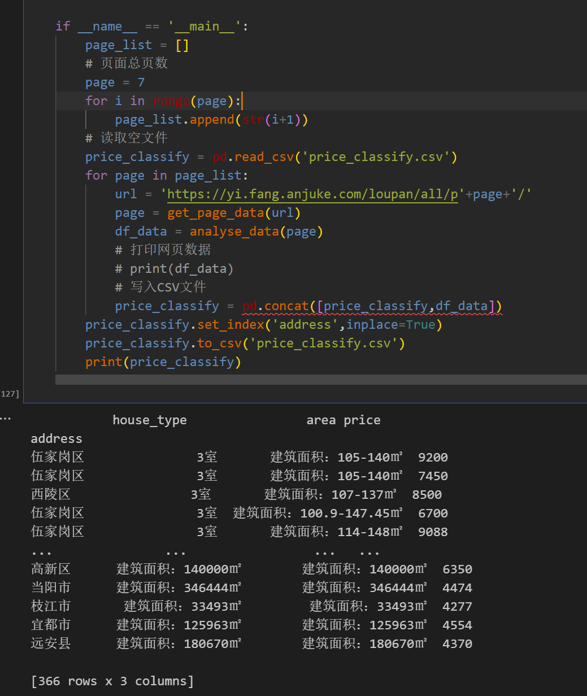
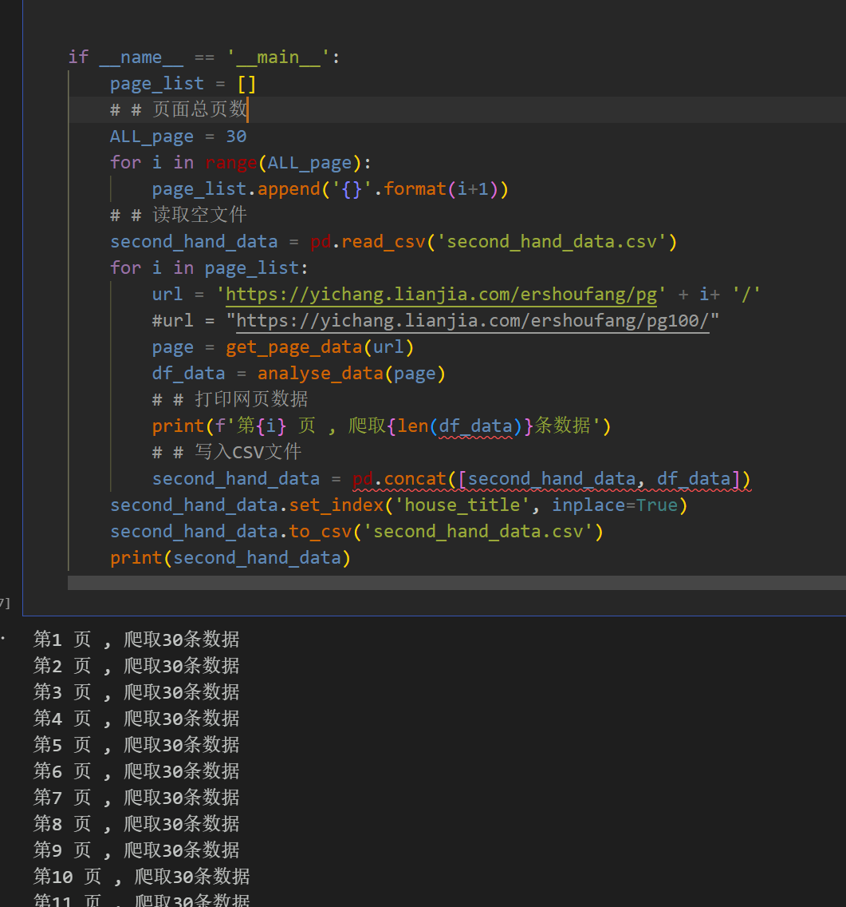
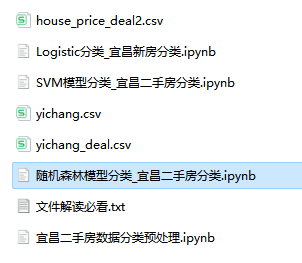
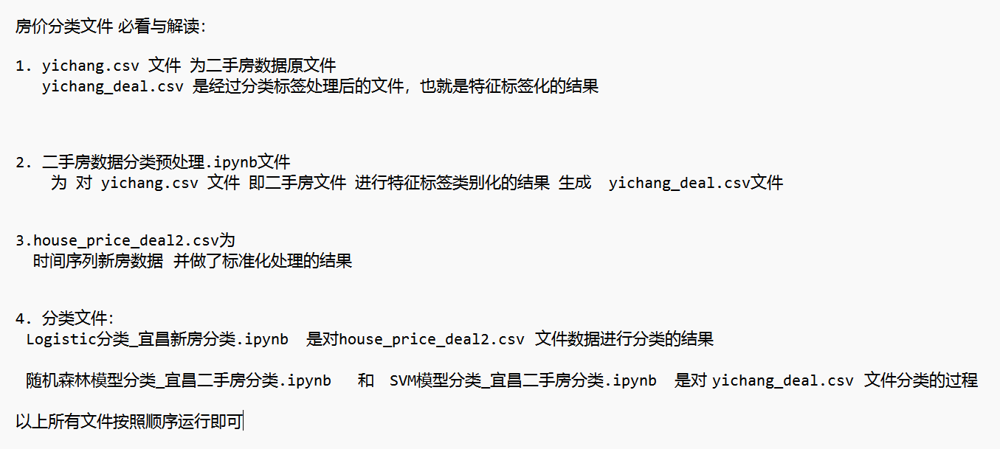
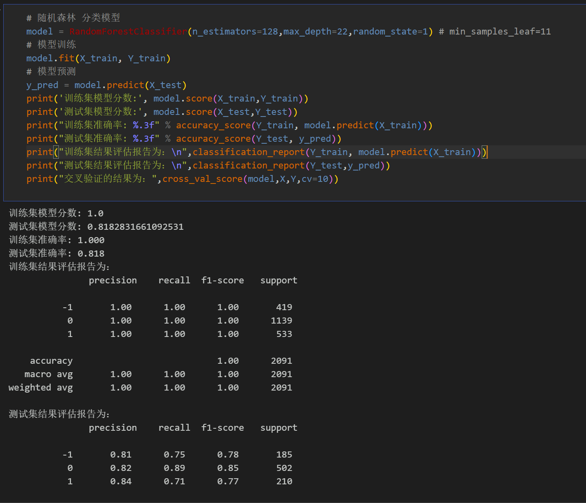
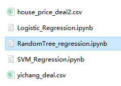
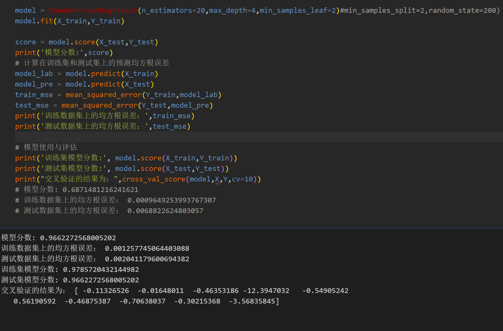

# Python implementation of house price crawling, classification, and regression prediction

Includes complete crawler code, housing price data, classification model analysis, regression prediction model analysis code, etc. All the corresponding codes can be run.
Due to the abundance of files, this is where I will classify them. Please note that before running the program, read the file interpretation first!
Environment: Python 3.9
Overall File Introduction:
I. Crawler File Introduction
\n        \n      ChainHome website crawling code demonstration:
\n        \n  
II. Classification File Introduction\n\nRandom Forest Classification Model:
III. Introduction to the Regression Prediction Files\nRandom Forest Regression Prediction Model Demonstration:
\n        \n  

## Images

<!-- PAYMENT_BLOCK -->

## Get this dataset

- Payment link (Stripe): [Buy now](https://buy.stripe.com/3cs8yP7sY87d0vu9AB)
- Payment QR code: 

<!-- /PAYMENT_BLOCK -->
